<h1></h1>

## Aktivitas GitHub

<!-- featured-repo:start -->

## Repo publik terbaru

## Tech stack

GitHub belum mendeteksi bahasa pada repo ini.

<!-- featured-repo:end -->

[Lihat repo publik](https://github.com/rkthooriq?tab=repositories) · [Sumber data kontribusi](https://github.com/rkthooriq#contribution-activity)
