<h1></h1>

## Aktivitas GitHub

## Catatan belajar

## Repo unggulan

[Lihat repo publik](https://github.com/rkthooriq?tab=repositories) · [Sumber data kontribusi](https://github.com/rkthooriq#contribution-activity)
